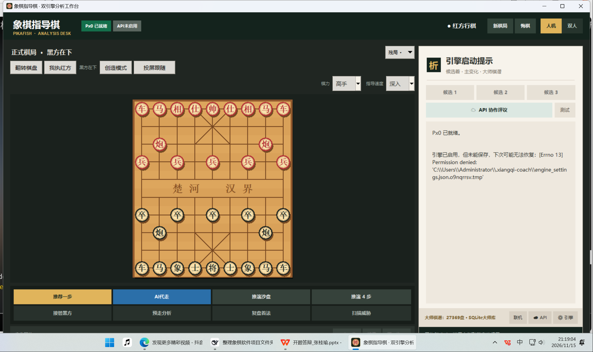

# 象棋指导棋 · 双引擎分析工作台

一个面向 Windows 的中国象棋教学/分析桌面程序：本地 Pikafish + Px0 双引擎、候选着与推演、
图片导入残局、投屏跟随、局域网联机，以及可选的 OpenAI 兼容 API 评议。



> 本项目是课程设计作品，按现状开源，不提供商业级保证。发布包中的第三方引擎、模型和棋谱库
> 分别遵循其上游许可，详见 [THIRD_PARTY_NOTICES.md](THIRD_PARTY_NOTICES.md)。

## 下载即玩（推荐给朋友）

1. 打开右侧 [Releases](../../releases)，下载最新的 `象棋指导棋_免安装版.zip`。
2. 解压到**可写目录**（桌面、下载目录都行，不要放 `Program Files`）。
3. 双击 `象棋指导棋.exe` 启动。不需要安装 Python、引擎或模型。

Windows 可能提示“未知发布者”或杀毒软件误报，选择“更多信息 → 仍要运行”或将程序加入信任即可；
这是未签名程序的正常提示。

## 本机直接运行（开发机）

```
课设象棋\
├─ 象棋指导棋.exe        ← 双击启动（无黑窗）
├─ 程序\                 ← 程序本体
└─ README.md
```

如果 exe 无法启动，运行 `程序\启动（控制台诊断）.bat`，它会保留控制台并显示完整错误信息；
启动失败详情也会写到 `程序\data\启动失败.log`。

## 从源码运行

要求：64 位 Windows 10/11、Python 3.11+（本机用 3.14 验证）。

```bat
:: 1. 首次运行：下载官方 Pikafish 引擎（约 51 MB）
程序\启动（控制台诊断）.bat

:: 2. 可选：安装图片识别依赖与模型（约 240 MB）
程序\安装图片识别.bat

:: 3. 可选：构建大师棋谱 SQLite 库（需要联网和 Git）
程序\scripts\setup_master_book.ps1
```

源码仓库不包含引擎、识别模型和大师棋谱库（体积与许可证原因），需要时用上面的脚本获取。

## 功能

- **人机对局**：Pikafish 强引擎，休闲到大师 7 档；Px0 可切换（CPU / 可选 GPU）。
- **分析工作台**：候选着、主变化、评分、推演沙盘、预走分析、复盘着法、扫描威胁。
- **对局控制**：悔棋、新棋局、翻转棋盘、我执红/黑、创造模式自由摆子。
- **图片导入残局**：本地截图识别，可手动框选/标四角修正。
- **投屏跟随**：校准手机投屏窗口后自动跟随，支持暂停、重试和人工接管。
- **局域网联机**：同一局域网创建/加入房间，双方同版本；仅私网、需防火墙授权。
- **大师棋谱**：基于 CCPD 公开数据集的 SQLite 开局实战查询（发布包内置）。
- **API 评议**：兼容 OpenAI `chat/completions` 接口；API Key 仅保存在本机用户目录。
- **防往返规则**：自定义的两点连续往返限制，适用于玩家、电脑、推演和联机。

更多说明见 [程序/文档](<程序/文档>)：局域网联机、投屏跟随、图片导入、翻转与创造模式、Px0 集成。

## 目录结构

```
课设象棋\
├─ 象棋指导棋.exe            启动器（.NET Framework 4.x，带图标、无控制台）
├─ 程序\
│  ├─ 启动.pyw               无控制台启动入口（异常弹窗 + 日志）
│  ├─ app.py                 主程序（Tkinter）
│  ├─ assets\app.ico         应用图标
│  ├─ 启动（控制台诊断）.bat   排错用启动方式
│  ├─ 安装图片识别.bat
│  ├─ 程序源码 *.py、screen_follow\、tests\、scripts\
│  ├─ 文档\                  使用说明与更新记录
│  ├─ engine\                Pikafish / Px0（源码仓库不包含）
│  ├─ models\                识别模型（源码仓库不包含）
│  └─ data\                  大师棋谱库与运行日志（源码仓库不包含）
├─ docs\screenshot.png
├─ README.md
└─ 第三方许可与来源：THIRD_PARTY_NOTICES.md
```

## 朋友免安装版与开发机的功能差异

免安装版（Release）与当前开发机的唯一**功能缺失**是 GPU 加速的 Px0 GPU 引擎：

1. **Px0 GPU 不随包提供**（CUDA/cuDNN 运行时约 1.3 GB，仅 NVIDIA 显卡可用）。
   - 朋友默认使用 Pikafish，也可以手动切 Px0 CPU；棋力不降级，但分析速度/深度取决于其 CPU。
   - 有 NVIDIA 显卡的高级用户可在解压目录运行 `程序\scripts\setup_px0_gpu.py` 自行补齐
     （联网约 1.2 GB，并需在引擎设置中手动配置），该路径未在他人电脑上验证。

以下功能**都在**，但朋友需要自己配置或满足环境条件：

2. **API 评议/代走**：开发者自己的 API Key、URL、模型名不会上传；朋友需要自己填写。
3. **局域网联机**：仅同一局域网；双方同版本；需要 Windows“专用网络”、开启防火墙并同意一次 UAC 授权。
4. **投屏跟随**：需要朋友自己安装 ToDesk（或类似手机投屏软件），程序不附带第三方投屏工具。
5. **图片识别**：依赖和模型已打包，但识别在 CPU 上运行；极老 CPU（缺 AVX2）或缺少 VC++ 运行库时可能失败。
6. **Px0 CPU**：已打包，但该 exe 是按 Ryzen 7 5700X 编译的，其他 CPU 不保证兼容，失败时会退回 Pikafish。
7. **大师棋谱**：发布包已内置 SQLite 库，体验与开发机一致；自行重建才需要联网和 Git。
8. **个人设置**：棋力、指导速度、执方、引擎选择和 API 配置各自保存在本机，不会随包携带。
9. **系统环境**：仅 64 位 Intel/AMD Windows 10/11；建议中文 Windows（界面使用微软雅黑/宋体）。
10. **未签名程序**：首次运行可能遇到 SmartScreen 或杀毒软件提示，需要手动放行。
11. **更新方式**：没有自动更新；程序更新后需要重新下载新包。

## 数据与隐私

- 用户配置：`%USERPROFILE%\.xiangqi-coach\`（引擎设置、界面偏好、API 设置）。
- 运行日志：`程序\data\logs\engine.log`。
- API Key 默认不落盘；只有勾选“明文保存到本机配置”才会写到用户目录，且不会上传到 Git。
- 图片识别、投屏跟随默认只在本机处理；只有显式点击 API 相关按钮才会发起网络请求。

## 从源码构建启动器 / 免安装包

需要 .NET Framework 4.x（Windows 自带）和 Python 3.11+：

```powershell
# 重新生成根目录的 象棋指导棋.exe（图标在 程序\assets\app.ico）
程序\scripts\build_launcher.ps1

# 生成免安装包（需要本机已装好识别依赖；输出到 build\）
程序\scripts\build_portable.ps1
```

## 测试

```bat
cd 程序
python -m pytest tests\test_rules.py tests\test_notation.py tests\test_repetition.py -q
python tests\smoke_gui_startup.py
```

部分 smoke/verify 脚本会启动真实引擎或识别进程，按需运行。

## 第三方与许可

- Pikafish：GPLv3，官方发布页与源代码见 [THIRD_PARTY_NOTICES.md](THIRD_PARTY_NOTICES.md)。
- Px0：GPLv3，源码归档与许可证在 `程序\engine\px0\`（发布包内）。
- 识别模型：AGPL-3.0 / Apache-2.0，来源和校验值见 `程序\models\board_recognition\`。
- 大师棋谱：CCPD，CC BY 4.0，来源与归属见 [THIRD_PARTY_NOTICES.md](THIRD_PARTY_NOTICES.md)。
- 本项目自身代码未附加开源许可证；公开仓库不等于放弃版权，如需授权请联系作者。
